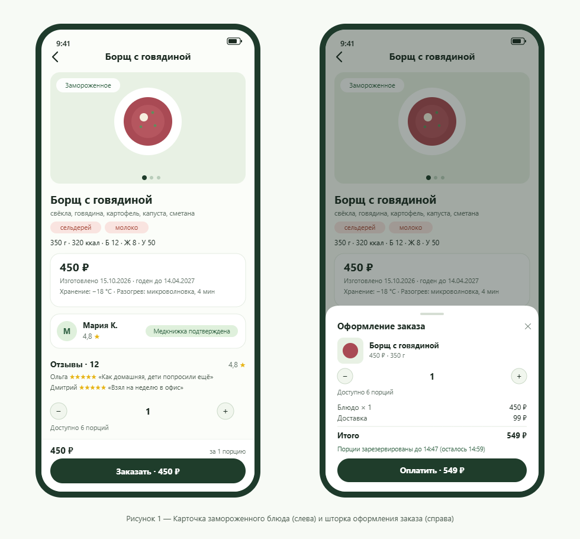
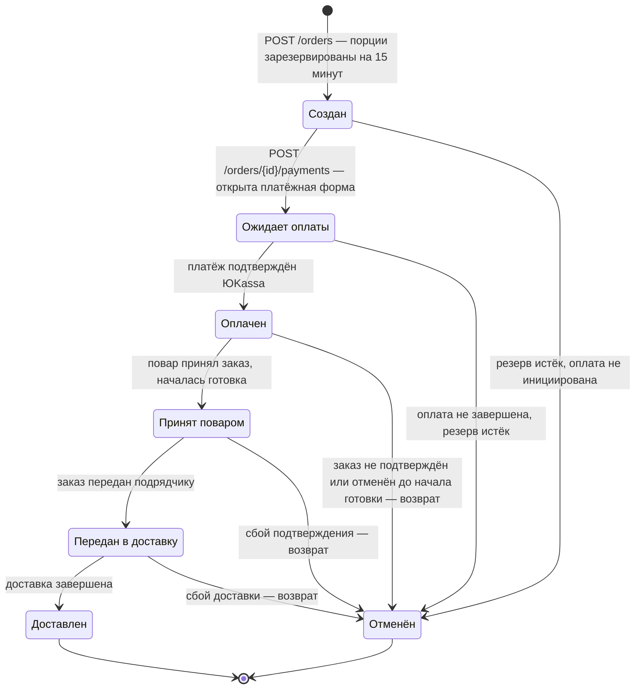

> Техническое задание на разработку экрана «Карточка замороженного блюда с оформлением заказа и оплатой» мобильного приложения Fropti.

**Система:** Fropti — мобильное приложение планирования домашнего питания (offline-first)

**Версия документа:** 1.0

**Дата:** 30.10.2026

---

## 1. Назначение ПО

Fropti — offline-first мобильное приложение для планирования домашнего питания. Базовые функции работают без сети на локальной SQLite: каталог рецептов, «холодильник», список покупок, автоматическая генерация меню с учётом продуктов дома. Сервер используется для маркетплейса домашней заморозки, оплат и обновления каталогов.

**Платформы:** iOS 15+ (Swift/SwiftUI), Android 9+ (Kotlin/Jetpack Compose).

**Возможности (кратко):**

- просмотр рецептов, ведение «холодильника» и списка покупок;
- автоматическая генерация меню на период;
- просмотр каталога заморозки своего района (офлайн, из кэша);
- заказ замороженных блюд домашней кухни у повара-исполнителя района;
- оплата через ЮKassa; доставка сторонним подрядчиком (Яндекс.Доставка, по API), одна доставка на неделю.

Настоящий фрагмент ТЗ описывает экран «Карточка замороженного блюда» и шторку оформления заказа и оплаты.

## 2. Проектные материалы

| Артефакт | Назначение | Ссылка |
|---|---|---|
| Концепция системы | Продукт, акторы, границы системы | [Ссылка на концепцию системы] |
| Рецензия на концепцию | Замечания рецензентов, учтённые в ТЗ | [Ссылка на рецензию] |
| Макеты экрана (iOS/Android) | Визуальный дизайн, состояния экрана | [Ссылка на макеты] |
| Спецификация API | Контракты endpoint'ов, коды ошибок | [Ссылка на спецификацию API] |

## 3. Экран «Карточка замороженного блюда»

### 3.1. Скрин из макета

*Рисунок 1 — Карточка замороженного блюда (слева) и шторка оформления заказа (справа).*

### 3.2. Точки входа

| Точка входа | Элемент перехода | Передаётся |
|---|---|---|
| Каталог заморозки района | тап по карточке блюда | dishId |
| Подбор заморозки при «делегировании» дня планировщика | тап по блюду-кандидату | dishId |
| Карточка блюда в меню (блюдо ранее добавлено из заморозки) | тап по блюду в дне меню | dishId |
| Карточка другого блюда | цепочка «блок повара → профиль повара → другое блюдо повара» | dishId |
| Профиль повара | тап по блюду в списке блюд повара | dishId |

Переход выполняется общим роутером приложения. В стеке допускается несколько карточек блюд; тап «Назад» возвращает на один экран. Повторное открытие карточки того же блюда обновляет данные.

### 3.3. Доступ к экрану

- Просмотр карточки доступен без авторизации.
- Заказ требует авторизованный аккаунт. При тапе «Заказать» неавторизованным показывается алерт «Войдите, чтобы заказать блюдо» с кнопками «Войти» и «Отмена». «Войти» открывает экран входа (вне рамок ТЗ). После успешного входа пользователь возвращается на карточку; шторка открывается автоматически, выбранное количество порций сохраняется.
- При `availablePortions = 0` кнопка «Заказать» заменяется на неактивную «Нет в наличии» независимо от авторизации.

### 3.4. Описание элементов экрана

#### 3.4.1. Навбар

- **Поведение:** закреплён сверху; слева кнопка «Назад» (иконка стрелки), заголовок — название блюда, обрезается одной строкой. Тап «Назад» возвращает на предыдущий экран.
- **Состояния:** всегда видим; при офлайн под ним показывается баннер неактуальности данных (см. 3.7).
- **Источник данных:** `title`.

#### 3.4.2. Галерея изображений

- **Поведение:** горизонтальная карусель на ширину экрана, точки-индикаторы, свайп между слайдами. Первый слайд — блюдо в замороженном виде с подписью «Замороженное», второй — в готовом виде с подписью «После разогрева». При большем количестве изображений листаются далее.
- **Состояния:** загрузка — скелетон; офлайн — из кэша изображений по URL; изображение недоступно — плейсхолдер.
- **Источник данных:** массив `images` из `GET /dishes/{id}`; поля `images[].url`, `images[].kind` (`"frozen"` | `"ready"`).

#### 3.4.3. Название, состав, аллергены, вес порции, КБЖУ

- **Поведение:** статичный текстовый блок. Состав — текст. Аллергены — отдельные метки (чипы). Ниже — параметры: «Вес порции: 350 г», «На порцию: 320 ккал · белки 12 г · жиры 8 г · углеводы 50 г».
- **Состояния:** при пустом `allergens` блок аллергенов не выводится.
- **Источник данных:** `title`, `composition`, `allergens[]`, `portionWeight`, `calories`, `proteins`, `fats`, `carbohydrates`.

#### 3.4.4. Цена, срок и условия хранения, способ разогрева

- **Поведение:** цена за порцию выводится крупно в блоке и дублируется итогом на кнопке «Заказать». Ниже строки: «Изготовлено 15.10.2026», «Годен до 14.04.2027», «Хранение: −18 °C», «Разогрев: …» (текст из ответа).
- **Состояния:** при офлайн блок помечается баннером неактуальности (3.7).
- **Источник данных:** `price`, `productionDate`, `bestBefore`, `storageConditions`, `reheating`.

#### 3.4.5. Блок повара

- **Поведение:** карточка повара: аватар, имя, рейтинг (звёзды + число), бейдж «Медкнижка подтверждена». Тап по блоку открывает профиль повара.
- **Состояния:** бейдж медкнижки выводится только при `cook.hasMedicalBook = true`; без подтверждения бейдж не выводится.
- **Источник данных:** вложенный объект `cook` из `GET /dishes/{id}`: `cook.id`, `cook.name`, `cook.avatarUrl`, `cook.rating`, `cook.hasMedicalBook`. Профиль повара загружается отдельным экраном через `GET /cooks/{id}` (см. 3.10).

#### 3.4.6. Рейтинг и отзывы покупателей

- **Поведение:** заголовок «Отзывы · N» и сводный рейтинг блюда (число + звёзды). Под заголовком подпись «Отзывы могут оставлять только купившие это блюдо». Ниже — список отзывов: имя автора, оценка звёздами, текст, дата. Написание отзыва — вне рамок экрана.
- **Состояния:** загрузка следующей страницы — спиннер в конце списка; пустое состояние (онлайн, `reviewsCount = 0`) — «Отзывов пока нет»; офлайн — «Отзывы загрузятся при подключении к сети» (тексты отзывов офлайн недоступны — кэшируются только сводный рейтинг и число отзывов из `GET /dishes/{id}`); при `hasMore = false` подгрузка останавливается.
- **Источник данных:** сводный рейтинг — `rating`, `reviewsCount` из `GET /dishes/{id}`; список — `GET /dishes/{id}/reviews`: `items[].authorName`, `items[].rating`, `items[].text`, `items[].createdAt`, признак `hasMore`.

#### 3.4.7. Закреплённая нижняя панель

- **Поведение:** панель закреплена внизу поверх скролла. Содержит цену и кнопку «Заказать · 450 ₽» (итог по выбранному количеству). Тап открывает шторку (3.6).
- **Состояния:** сеть есть и `availablePortions > 0` — кнопка активна; `availablePortions = 0` — неактивная кнопка «Нет в наличии»; офлайн — вместо кнопки баннер «Для заказа нужен интернет».
- **Источник данных:** `price`, `availablePortions`.

### 3.5. Селектор порций

- **Расположение:** селектор размещается на карточке, над закреплённой нижней панелью (3.4.7). Тот же селектор с тем же значением отображается в шторке (3.6.1); значения синхронизируются в обе стороны.
- **Поведение:** кнопки «−»/«+» и текущее значение; шаг изменения — 1; минимум — 1; максимум — `availablePortions`. Начальное значение — 1. При изменении пересчитывается итог на кнопке «Заказать» и в шторке. Рядом — подпись «Доступно N порций».
- **Состояния:** «+» неактивен при достижении `availablePortions`, «−» — при значении 1; при `availablePortions = 0` селектор недоступен, выводится «Нет в наличии»; если после обновления данных выбранное значение превышает остаток — значение автоматически уменьшается до остатка, показывается тост «Доступно N порций».
- **Склонение:** 1 порция / 2 порции / 5 порций (правила — см. 3.9).
- **Источник данных:** `availablePortions`, `price`.

### 3.6. Шторка оформления заказа и оплаты

#### 3.6.1. Состав шторки

- Заголовок «Оформление заказа», крестик закрытия, свайп вниз.
- Состав заказа: миниатюра (`images[0].url`), `title`, цена за порцию.
- Количество порций: селектор по правилам 3.5; изменение пересчитывает итог. После создания заказа селектор блокируется с подписью «Количество зафиксировано» — для изменения нужно закрыть шторку и оформить заново.
- Расчёт: «Блюдо × N — X ₽», «Доставка — Y ₽», «Итого — Z ₽».
- Строка резерва (после создания заказа): «Порции зарезервированы до 14:47» с обратным отсчётом.
- Кнопка «Оплатить · Z ₽».

#### 3.6.2. Пересчёт итога

Итог = `price` × количество + `deliveryPrice`. Пересчёт — при каждом изменении количества. Расчёт на клиенте предварительный; финальную сумму всегда возвращает сервер в ответе `POST /orders` (поля `price`, `itemsTotal`, `deliveryPrice`, `total`).

#### 3.6.3. Сценарий оплаты

1. Тап «Оплатить» → `POST /orders` с телом `{dishId, quantity}`. Кнопка блокируется, состояние «Проверяем наличие…».
2. Успех: шторка обновляет суммы по ответу, показывает строку резерва (`reservedUntil`), затем вызывается `POST /orders/{orderId}/payments`.
3. Успех: приложение открывает `confirmationUrl` во внешнем браузере (Android Custom Tabs / iOS SFSafariViewController). Шторка переходит в состояние «Ожидает оплаты».
4. После оплаты пользователь возвращается в приложение по deep link. Показывается алерт «Оплата обрабатывается. О результате сообщим уведомлением». Финальный статус приходит push-уведомлением («Оплачен» или «Отменён»).
5. Возврат без оплаты: шторка в состоянии «Ожидает оплаты» с подписью «Оплата не завершена. Резерв снимется в 14:47». Повторный тап «Оплатить» вызывает только `POST /orders/{id}/payments` — новый заказ не создаётся, пока жив резерв.
6. Повторное открытие шторки при живом резерве показывает существующий заказ (`orderId`) и остаток времени резерва.

#### 3.6.4. Проверка наличия и резервирование порций

- Резерв создаётся сервером при `POST /orders` и действует 15 минут (`reservedUntil`); снимается автоматически, если оплата не поступила.
- Если наличие или цена изменились, сервер отвечает ошибкой 409:
  - `out_of_stock` (порций больше нет) — алерт «Блюдо закончилось»; шторка закрывается, карточка обновляется, кнопка «Нет в наличии»;
  - `insufficient_portions` (доступно меньше выбранного) — алерт «Доступно только N порций», кнопки «Продолжить с N» (селектор корректируется, итог пересчитывается, повторный `POST /orders`) и «Отмена»;
  - `price_changed` (цена изменилась) — алерт «Цена изменилась: X ₽ за порцию. Итого Y ₽», кнопки «Оплатить по новой цене» (цены в шторке обновляются, повторный `POST /orders`) и «Отмена».
- Закрытие шторки с созданным неоплаченным заказом — алерт «Закрыть оформление? Резерв порций снимется через N минут» с кнопками «Закрыть» и «Продолжить оплату».

#### 3.6.5. Ошибки оплаты и доставки

| Ситуация | Что видит пользователь | Дальнейшее действие |
|---|---|---|
| Нет сети при тапе «Оплатить» | Тост «Нет соединения. Проверьте интернет и попробуйте ещё раз» | Кнопка снова активна, повтор вручную |
| Резерв истёк (`reservation_expired`) | Алерт «Время резерва истекло. Повторите оплату — мы перепроверим наличие» | Повторный тап создаёт новый заказ (`POST /orders`) |
| Ошибка создания платежа (5xx) | Тост «Не удалось начать оплату. Попробуйте ещё раз» | Заказ остаётся созданным до истечения резерва; повторный тап — только `POST /orders/{id}/payments` |
| Доставка недоступна (`delivery_unavailable`) | Алерт «Доставка на этой неделе недоступна. Попробуйте оформить заказ позже» | Шторка закрывается |
| Оплата прошла, заказ подтвердить не удалось | Push «Заказ не удалось подтвердить. Деньги вернутся автоматически» + алерт при возврате в приложение | Возврат выполняет сервер автоматически; действий пользователя не требуется |

Уведомления: пользователь информируется push-уведомлением и алертом в приложении; автоматический возврат инициирует сервер через ЮKassa.

#### 3.6.6. Возвраты

- При отмене заказа до начала готовки деньги возвращаются полностью на способ оплаты.
- Возврат выполняет сервер через ЮKassa; срок зачисления — 1–7 рабочих дней.
- Текст для пользователя: «Деньги вернутся на карту в течение 1–7 рабочих дней» (алерт/push).
- Приложение не инициирует возврат само и не требует действий от пользователя.

### 3.7. Offline-поведение экрана

- Каталог заморозки района кэшируется в SQLite; экран полностью открывается офлайн (кроме отзывов).
- При офлайн-открытии под навбаром — баннер «Нет сети. Данные могут быть неактуальны».
- Кнопка «Заказать» при офлайн недоступна: вместо неё баннер «Для заказа нужен интернет».
- Отзывы офлайн не показываются: тексты отзывов не кэшируются. Доступны только сводный рейтинг и число отзывов (`rating`, `reviewsCount`) из кэша `GET /dishes/{id}`; в блоке отзывов — заглушка «Отзывы загрузятся при подключении к сети».
- Изображения — из локального кэша по URL; отсутствующие — плейсхолдер.
- При появлении сети автоматически вызывается `GET /dishes/{id}`, данные и кэш обновляются, баннер скрывается, кнопка «Заказать» возвращается (при `availablePortions > 0`).
- Сеть есть, сервер недоступен (timeout, 5xx): баннер «Не удалось обновить данные. Показываем сохранённые», экран работает как офлайн.

### 3.8. Особенности поведения всего экрана

- Контент скроллится вертикально; галерея — горизонтальный свайп внутри вертикального скролла.
- Нижняя панель (кнопка «Заказать» / «Нет в наличии» / баннер офлайн) закреплена и не скроллится.
- Pull-to-refresh отсутствует. Обновление — при открытии экрана и при появлении сети.
- Автоподгрузка отзывов: при достижении конца списка загружается следующая страница (10 отзывов) через `GET /dishes/{id}/reviews`.
- Шторка — модальная, затемняет подложку; закрывается крестиком или свайпом вниз (с предупреждением при живом резерве, 3.6.4).
- Ввод с клавиатуры не используется: количество порций меняется только кнопками.

### 3.9. Форматы и правила отображения данных

| Данные | Правило | Пример |
|---|---|---|
| Дата изготовления | «изготовлено ДД.ММ.ГГГГ» | изготовлено 15.10.2026 |
| Срок годности | «до ДД.ММ.ГГГГ» | до 14.04.2027 |
| Вес порции | целое число, «N г» | 350 г |
| Калорийность | «N ккал/порция» | 320 ккал/порция |
| Белки, жиры, углеводы | «N г», до одной цифры после запятой | 12 г; 8,5 г |
| Цена | «N ₽», целые рубли без копеек; копейки — через запятую | 450 ₽; 450,50 ₽ |
| Рейтинг | одна цифра после запятой, разделитель — запятая (формат 0.0) | 4,8 |
| Звёзды рейтинга | округление до ближайшей половины звезды | 4,8 → 5; 4,2 → 4; 4,3 → 4,5 |
| Число отзывов | число + склонение | 12 отзывов |
| Время резерва | сервер передаёт `reservedUntil` в ISO 8601 (UTC); отображается в локальном времени устройства в формате «ЧЧ:ММ», с обратным отсчётом | до 14:47 |

**Склонение слова «отзыв»:**

- «отзыв» — последняя цифра 1, кроме 11 → 1 отзыв, 21 отзыв, но 11 отзывов;
- «отзыва» — последняя цифра 2–4, кроме 12–14 → 2 отзыва, 23 отзыва, но 12 отзывов;
- «отзывов» — остальные случаи → 5 отзывов, 11 отзывов, 112 отзывов.

Аналогично склоняется «порция / порции / порций».

### 3.10. Используемые запросы к серверу

| # | Метод и путь | Момент вызова | Параметры / тело | Основные поля ответа |
|---|---|---|---|---|
| 1 | `GET /dishes/{id}` | открытие экрана; появление сети после офлайн | path: `id` | `id`, `title`, `composition`, `allergens[]`, `portionWeight`, `calories`, `proteins`, `fats`, `carbohydrates`, `price`, `productionDate`, `bestBefore`, `storageConditions`, `reheating`, `images[{url, kind}]`, `availablePortions`, `rating`, `reviewsCount`, `deliveryPrice`, `cook{id, name, avatarUrl, rating, hasMedicalBook}`, `updatedAt` |
| 2 | `GET /dishes/{id}/reviews` | блок отзывов попадает в видимую область; достижение конца списка | query: `page` (с 0), `size = 10` | `items[{id, authorName, rating, text, createdAt}]`, `hasMore` |
| 3 | `GET /cooks/{id}` | переход в профиль повара из блока повара (вызов выполняется экраном профиля) | path: `id` | `id`, `name`, `rating`, `hasMedicalBook`, `dishes[]` |
| 4 | `POST /orders` | тап «Оплатить» в шторке, если нет живого резерва | body: `{dishId, quantity}` | `orderId`, `status`, `reservedUntil`, `price`, `itemsTotal`, `deliveryPrice`, `total` |
| 5 | `POST /orders/{id}/payments` | после успешного `POST /orders`; повторный тап «Оплатить» при живом резерве | path: `orderId` | `paymentId`, `confirmationUrl`, `status` |

**Общее поведение при успехе/ошибке:**

- Успех — обновление UI: данные карточки, суммы шторки, строка резерва, переход по `confirmationUrl`.
- Ошибка — тост или алерт с причиной и дальнейшим действием (см. 3.6.4–3.6.5): 401 — неавторизован, переход на экран входа; 404 — блюдо не найдено, тост «Блюдо больше не публикуется», экран закрывается; 409 — конфликты наличия/цены/доставки; 410 — резерв истёк; 5xx и отсутствие сети — тост с возможностью повторить.

### 3.11. Статусная модель заказа

| Статус | Описание | Что видит пользователь |
|---|---|---|
| Создан | Заказ зарегистрирован, порции зарезервированы на 15 минут, платёж не инициирован | Шторка: «Порции зарезервированы до ЧЧ:ММ», кнопка «Оплатить» |
| Ожидает оплаты | Платёж создан в ЮKassa, пользователь на платёжной форме или вернулся без подтверждения | Шторка: «Оплата не завершена. Резерв снимется в ЧЧ:ММ» |
| Оплачен | Платёж подтверждён, заказ ожидает приёмки поваром | Push «Заказ оплачен»; карточка доступна для нового заказа |
| Принят поваром | Повар подтвердил заказ и начал готовку; отмена с возвратом невозможна | Push; детали — на экране заказов (вне рамок ТЗ) |
| Передан в доставку | Заказ передан подрядчику (Яндекс.Доставка) | Push; отслеживание — на экране заказов |
| Доставлен | Доставка завершена; терминальный статус | Push; пользователь может оставить отзыв (вне рамок экрана) |
| Отменён | Терминальный. Причины: истечение резерва, незавершённая оплата, неподтверждение поваром, сбой доставки. Если оплата прошла — автоматический полный возврат | Push «Заказ отменён. Деньги вернутся в течение 1–7 рабочих дней» |

Отмена с возвратом доступна пользователю только до начала готовки (до статуса «Принят поваром»). Управление отменами выполняется на экране заказов и сервером; на данном экране — только уведомления.

### 3.12. Материалы

API:

1. `GET /dishes/{id}` — детали блюда (карточка, кэш каталога района).
2. `GET /dishes/{id}/reviews` — отзывы о блюде, постранично.
3. `GET /cooks/{id}` — профиль повара (переход из блока повара).
4. `POST /orders` — создание заказа с резервом порций на 15 минут.
5. `POST /orders/{id}/payments` — создание платежа ЮKassa, возвращает `confirmationUrl`.

Макеты: [Ссылка на макеты iOS], [Ссылка на макеты Android]

Спецификация API: [Ссылка на спецификацию API]

---

## Допущения

1. Подтверждение результата оплаты приходит push-уведомлением; экран «Мои заказы» и проверка статуса заказа GET-запросом — вне рамок фрагмента (в спецификации фиксированы ровно пять endpoint'ов).
2. Платёжная форма ЮKassa открывается во внешнем браузере (Custom Tabs / SFSafariViewController); возврат — по deep link `fropti://payment/result`.
3. `deliveryPrice` единая для района на неделю и приходит в `GET /dishes/{id}`; финальную сумму всегда возвращает `POST /orders`.
4. Тексты отзывов не кэшируются; офлайн доступны только сводный рейтинг и число отзывов (`rating`, `reviewsCount`) из кэша `GET /dishes/{id}`. Загрузка и подгрузка страниц отзывов требуют сеть.
5. Экраны входа, профиля повара и «Мои заказы» описываются отдельными разделами ТЗ; здесь зафиксированы только переходы и уведомления.
6. Все возвраты инициирует сервер через ЮKassa; клиент возвраты не выполняет.
7. Размер страницы отзывов — 10; счётчик страниц начинается с 0.
8. Изменение количества порций после создания заказа не допускается (требует нового заказа) — так резерв на сервере всегда соответствует сумме.
